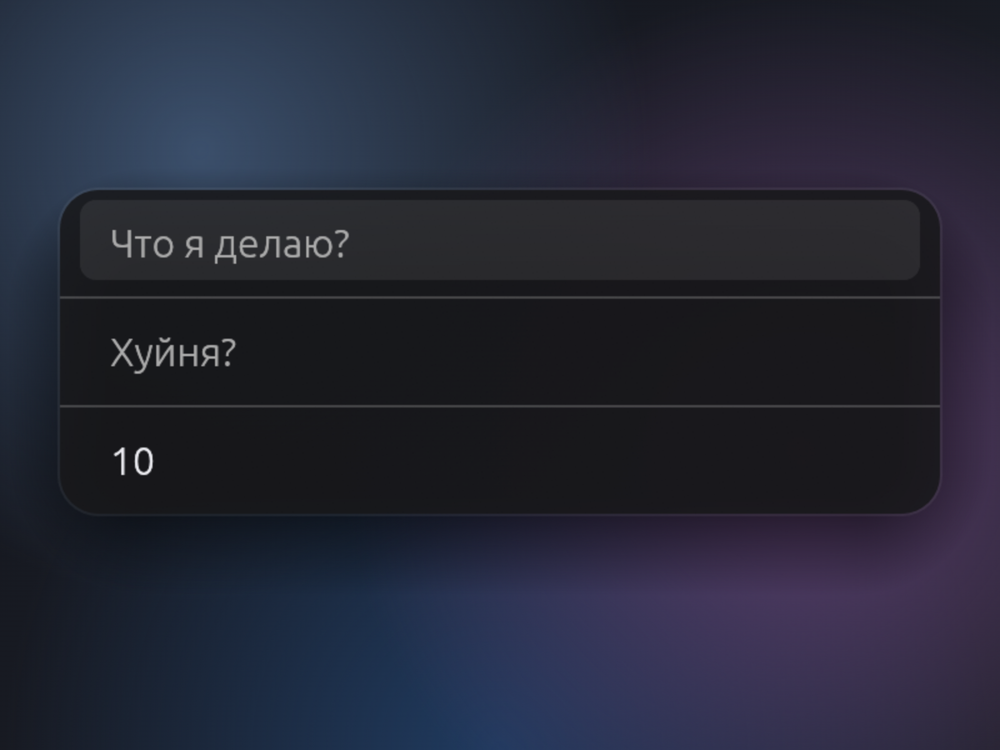

# Nudge — interval journaling for focus

A periodic spotlight popup for Windows and macOS that asks you "what are you
doing?" and "is it bullshit?". Answers are written to an append-only NDJSON
journal.



## How it works

1. Nudge sits in the system tray, the timer ticks.
2. Timer expires → a spotlight popup appears in the center of the screen
   (always on top, like Spotlight / Claude quick chat).
3. The user answers → Enter → the popup hides, the timer restarts.
4. Answers are appended to `journal-rust.ndjson`.

## Popup

Minimalist window in the center of the screen, on top of all other windows.
Opens focused on the first field.

### Fields (Tab to switch)

| # | Field (Russian product copy — the actual questions) | Type | Description |
|---|------|-----|----------|
| 1 | Что я делаю? | text | Free-form input, focused on open |
| 2 | Хуйня? | text | Free-form input, reflection |
| 3 | Следующий через (мин) | number (min) | Pre-filled with the current interval (default 10 min) |

- **Enter** — save and close
- **Esc** — close without saving (whether the timer restarts depends on how
  the popup was opened — see below)

Everything the popup does is one state machine: three states, four events,
no rules outside the transition table. It is specified in
[docs/design-spec.md](docs/design-spec.md) §4 and there is a clickable model
of it in [docs/state-machine.html](docs/state-machine.html).

## Journal

NDJSON file (`journal-rust.ndjson`), append-only, one JSON record per line:

```jsonl
{"schema_version":1,"event_type":"submitted","entry_id":"01JS1S8R5W4Y4S4M8Q6A8X7R2V","captured_at":"2026-04-08T14:30:00.000+03:00","implementation":"rust","trigger_source":"timer","doing":"writing requirements","bullshit":"no","next_interval_minutes":10}
{"schema_version":1,"event_type":"submitted","entry_id":"01JS1S9FDRW4K4M7R4F5R9A5A2","captured_at":"2026-04-08T14:40:00.000+03:00","implementation":"rust","trigger_source":"timer","doing":"got sucked into YouTube","bullshit":"yes","next_interval_minutes":5}
```

Full contract: [docs/journal-spec.md](docs/journal-spec.md)

## Tray

- Tray icon — a daisy that drops petals as the next nudge approaches (this
  is the time-remaining indicator, see `docs/design-spec.md` §5).
- Tooltip: `~N min` (rounded up, refreshed once per minute); `now` after the
  timer expires.
- Left click: open the popup (does not affect the timer).
- Right click: context menu — `Show Nudge`, `Settings`, `Quit`.

## Stack

- **Rust** (native, no web engines).
- GUI: eframe / egui (glow renderer, transparent window).
- Goal: minimal footprint (~10-20 MB RAM), instant startup, single binary.

## Defaults

- Interval: **10 minutes** — field `default_interval_minutes` in
  `config.json`, any positive number (integer or decimal).
- Journal: `<Documents>/Nudge/journal-rust.ndjson` — `%USERPROFILE%\Documents`
  on Windows, `~/Documents` on macOS.
- Config: `%USERPROFILE%\Documents\Nudge\config.json` on Windows,
  `~/Library/Application Support/Nudge/config.json` on macOS. Not next to
  the journal there: Documents is TCC-gated and iCloud-synced, and a
  menu-bar agent should not have to ask for consent to read its own
  settings. A file left in `~/Documents/Nudge/` by an earlier version is
  moved on first launch.
- Hotkey: **Ctrl+Shift+Space** (`⌃⇧Space`) — opens the popup manually from
  any focused window. Field `hotkey` in `config.json`: any modifiers plus
  one key. `Ctrl`/`⌃`, `Alt`/`Option`/`⌥`, `Shift`/`⇧`,
  `Cmd`/`Win`/`⌘`, plus a letter, digit, `F1`–`F24`, `Space`, `Enter`,
  `Tab`, `Esc`, `Backspace`, an arrow, `Home`/`End`/`PageUp`/`PageDown`/
  `Insert`/`Delete`, or a symbol cap (`- = [ ] \ ; ' , . / ``) — e.g.
  `⌥⌘J`, `Alt+J`, `Ctrl+F12`, `⌃⇧←`. Case, spacing and the choice of
  spelling do not matter. A symbol cap is named by its unshifted legend, so
  `⇧/` and `?` are one combination. At least one modifier is required,
  except for `F1`–`F24`. `fn` cannot be part of a hotkey on macOS; see
  `docs/design-spec.md` §5 for why.
- Launch at login: field `autostart` (bool) — kept in sync with
  `HKCU\…\Run\Nudge` on Windows and with a LaunchAgent plist at
  `~/Library/LaunchAgents/com.wizard1209.nudge.plist` on macOS; see
  `docs/design-spec.md` §9.
- Sprite: a `sprite` block in the same `config.json` — `enabled`, `path`
  (an absolute path to a PNG with a transparent background), `x`, `y` (the
  sprite's top-left corner relative to the card's, in points, either may be
  negative) and `card_width` (the card's width while the sprite is on). Off
  by default. The PNG is drawn in front of the card at its native pixels;
  see `docs/design-spec.md` §10.

## Installing on macOS

Download the DMG from the Releases page, drag `Nudge.app` to Applications,
then clear the download quarantine:

```sh
xattr -dr com.apple.quarantine /Applications/Nudge.app
```

That step is needed because the app carries an ad-hoc signature rather than a
Developer ID, and macOS 15 removed the Control-click override that used to get
past Gatekeeper. The alternative is one trip through System Settings › Privacy
& Security › Open Anyway after the first launch is refused.

Nudge runs as a menu-bar agent: no Dock icon, no Cmd-Tab entry, and the daisy
in the menu bar is where Settings and Quit live.

## Settings

The settings window opens from the tray menu (`Settings`) and edits the same
`config.json` (hotkey, interval, autostart, sprite). Edits are picked up by
the running app immediately via a file watcher; a sprite change is applied
the next time the popup is hidden.

The sprite group has three rows with the five fields of the `sprite` block;
`Browse…` picks the PNG with the system's file dialog (macOS). `Save` refuses
an enabled sprite whose file is missing, not a PNG, or has no transparent
background, and says which.

The hotkey is typed in, in any of the spellings above — `⌥⌘J`, `Alt+Cmd+J`
and `alt+cmd+j` are one combination. Full grammar: `docs/design-spec.md` §5.
`Save` refuses a combination the OS cannot bind rather than writing it.

On macOS it can also be pressed instead of typed: `Record`, then the
combination. The keys are read from the OS rather than from the window
toolkit, so `⌘C` records as `⌘C` instead of copying, the keypad is its own key
rather than a fold onto the digit row, and a shortcut follows the physical cap
— with a Russian layout active, the cap that types `о` still records `⌥⌘J`.
`Esc`, `Cancel` and clicking away all put the saved value back. Windows has no
`Record` button: its platform facts are unmeasured, and
`docs/TASK-hotkey-native.md` is where that work is specified. Behaviour in
full: `docs/design-spec.md` §9.

If another application or macOS itself already holds the combination, `Save`
says so and saves it anyway — it is the shortcut the user asked for, and a
taken one binds normally, it just never fires.

## Development: the Electron prototype

This repo holds two implementations of the same spec. Alongside the Rust app
lives [`electron/`](electron/README.md) — the **prototyping harness** where new
features and design changes are tried first, because Electron is fast to build
and easy to inspect visually. The outcome is captured in the shared spec under
[`docs/`](docs), the contract both implementations follow, the tests are
derived from the spec, and the Rust port is written against them. The steps
are listed in [`electron/README.md`](electron/README.md). The released product
is the Rust binary only; the Electron app is a workbench, fully rewritable
from the spec.
